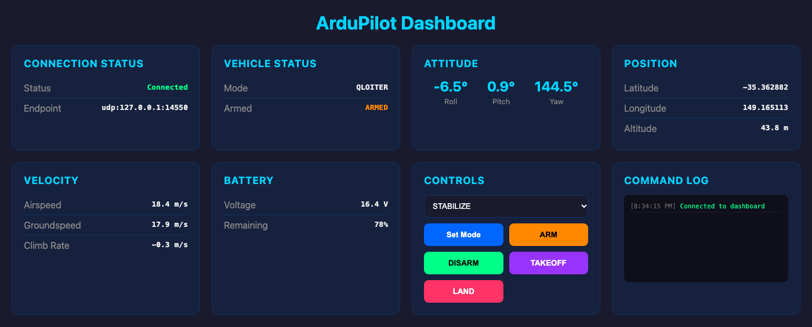

# ArduPilot MCP Server

MCP server for integrating Claude with ArduPilot SITL via MAVLink, plus a web dashboard for live telemetry and commands.



*Dashboard fed with synthetic MAVLink telemetry (QuadPlane, QLOITER).*

## Features

- **Telemetry**: Read vehicle attitude, position, velocity, and battery status
- **Mission Management**: Upload, download, and clear waypoint missions
- **Vehicle Commands**: Arm, disarm, set mode, takeoff, and land

## Requirements

- Python 3.10+ (tested with 3.12)
- ArduPilot SITL running locally

## Installation

```bash
# Create virtual environment
python3.12 -m venv venv
source venv/bin/activate

# Install dependencies
pip install -r requirements.txt
```

## Usage

### 1. Start ArduPilot SITL

```bash
# ArduCopter
sim_vehicle.py -v ArduCopter --console --map

# QuadPlane VTOL
sim_vehicle.py -v ArduPlane --frame quadplane --console --map
```

### 2. Test Connection

```bash
python test_connection.py
```

### 3. Configure Claude Code

```bash
claude mcp add ardupilot \
  -e MAVLINK_CONNECTION=udp:127.0.0.1:14550 \
  -- /path/to/VTOL-mcp-ardupilot/venv/bin/python /path/to/VTOL-mcp-ardupilot/ardupilot_mcp_server.py
```

### 4. Web dashboard (optional)

```bash
python dashboard.py   # http://localhost:8080
```

Shows connection, mode, arm state, attitude, position, velocity and battery, with buttons for set mode, arm, disarm, takeoff and land.

## Available Tools

| Tool | Description |
|------|-------------|
| `get_telemetry` | Get attitude, position, velocity, battery |
| `get_status` | Get mode, armed state, system status |
| `arm` | Arm vehicle motors |
| `disarm` | Disarm vehicle motors |
| `set_mode` | Change flight mode (GUIDED, AUTO, LOITER, etc.) |
| `takeoff` | Take off to specified altitude |
| `land` | Land at current position |
| `get_mission` | Download mission waypoints |
| `upload_mission` | Upload mission waypoints |
| `clear_mission` | Clear all waypoints |

## Configuration

Set the `MAVLINK_CONNECTION` environment variable to customize the connection:

```bash
# UDP (default)
export MAVLINK_CONNECTION="udp:127.0.0.1:14550"

# TCP
export MAVLINK_CONNECTION="tcp:127.0.0.1:5760"

# Serial
export MAVLINK_CONNECTION="/dev/ttyUSB0"
```

## Example Session

```
> Get the vehicle status
{"mode": "STABILIZE", "armed": false, ...}

> Set mode to GUIDED and arm
{"success": true, "mode": "GUIDED"}
{"success": true, "message": "Armed"}

> Take off to 10 meters
{"success": true, "altitude": 10}

> Get telemetry
{"attitude": {...}, "position": {"alt": 10.2}, ...}
```

## Tests

```bash
pytest -q   # 34 passed, 4 skipped without a running SITL
```

## License

MIT — see [LICENSE](LICENSE).
